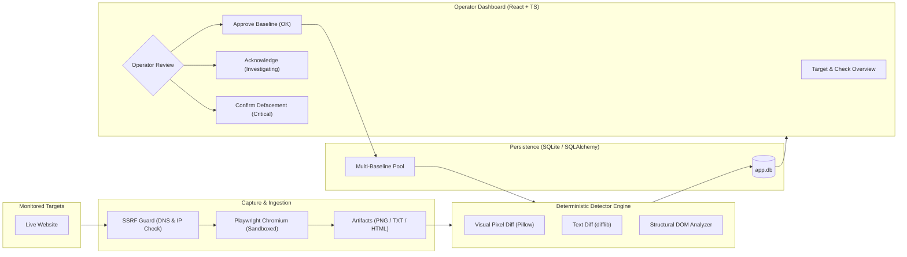

# Web Defacement Monitoring System

An automated, deterministic website integrity and unauthorized change detection platform. The system periodically captures high-fidelity browser snapshots of monitored web targets, extracts visible text, full-page screenshots, and structural DOM metadata, and compares them against verified, operator-approved reference baselines (**Baseline Snapshots**).

---

## Key Features

- **Deterministic Multi-Detector Engine:**
  - **Visual / Pixel Diffing:** High-speed channel difference analysis using Pillow C-extensions. Normalizes dynamic height changes and computes visual change scores (`visual_change_score`).
  - **Text Diffing:** Granular text difference analysis powered by `difflib.SequenceMatcher`, with an adaptive scaling strategy switching to line-level diffing on large documents (>100 KB).
  - **Structural & Script Injection Detection:** Inspects DOM structures, detects hidden iframes, rogue external scripts, event handlers, `javascript:` URLs, form action repointing, and malicious meta refresh tags, with domain allowlisting support.
- **Fail-Safe Headless Browser Rendering:**
  - Full client-side JavaScript execution via Playwright Chromium.
  - Overlays remain in captured evidence. Automatic consent/close clicks are disabled, including when the legacy `DISMISS_OVERLAYS` setting is true, because page handlers can erase injected content. Existing baselines captured after dismissal may need operator review when banners reappear.
  - Enforced browser sandbox isolation policy (`chromium_sandbox`) to securely handle untrusted external web content.
- **Multi-Baseline Management & Smart Selection:**
  - Supports multiple valid baselines per target (e.g. seasonal promotions, localized variations).
  - Dynamic matching selects the closest matching baseline to minimize false positives while honoring strict retention caps (`max_baselines_per_target`).
  - Every first capture, as well as captures after a URL change, remains a candidate until an authorized operator approves it. Manual recaptures create a newer candidate while keeping earlier captures in history; scheduled checks pause until approval.
- **Security-First Architecture:**
  - **SSRF Guard:** Pre-flight DNS resolution and IP validation blocking private CIDR ranges (RFC 1918), loopback, link-local, and IPv6 mapped addresses, with DNS rebinding protection.
  - **Local Authentication:** Cookie-based session authentication (`HttpOnly`, `SameSite=Lax`), Argon2id password hashing, and progressive brute-force rate-limiting and account lockout.
  - **Concurrency Control:** In-flight check deduplication and guards preventing target URL alterations during active check execution (HTTP 409 Conflict).
- **Operator Dashboard:**
  - Modern React 18 + TypeScript SPA with dark mode styling (Tailwind CSS).
  - **3-Panel Visual Diff Heatmap:** Side-by-side comparison (Baseline, Canvas Heatmap, Current) with interactive click-to-zoom modals.
  - **Real-Time Polling & Cache Reactivity:** Instant synchronization with background scheduler checks via TanStack Query.
  - **Server-Side Pagination:** Scalable target listing with pagination controls and accurate database counts.

---

## System Architecture



---

## Tech Stack

| Layer | Technology | Description |
| :--- | :--- | :--- |
| **Backend** | **FastAPI** (Python 3.11+) | Async REST API, Pydantic v2 schemas, Dependency Injection |
| **Headless Browser** | **Playwright** (Chromium) | Full-page captures, visible text, rendered HTML DOM |
| **Database & ORM** | **SQLite / SQLAlchemy 2.0** | Relational storage, Alembic migrations, explicit session flush safety |
| **Image & Text Processing** | **Pillow (PIL) & difflib** | Channel arithmetic, image histogram diffing, adaptive text diffing |
| **Frontend** | **React 18 + TypeScript + Vite** | High-performance SPA with client-side canvas processing |
| **Data Fetching** | **TanStack Query (React Query v5)** | Cache management, signature-based reactivity, polling synchronization |
| **Styling** | **Tailwind CSS + Lucide Icons** | Responsive modern Slate dark mode |
| **Testing & Quality** | **Pytest, Ruff, Mypy, Vitest** | Strict typing, full test coverage across backend and frontend |

---

## Getting Started

### Prerequisites

- **Operating System:** Linux (Ubuntu 22.04 / 24.04 LTS recommended) or any modern Linux distribution
- **Docker Deployment (Recommended):** Docker Engine 24.0+ & Docker Compose v2.0+
- **Host / Bare-Metal Deployment (Alternative):**
  - Python 3.11+ & `python3-venv`
  - Node.js 20+ & `npm`
  - System build dependencies: `build-essential`

---

### Option A: Running with Docker Compose (Recommended for Linux Server)

The easiest and most isolated way to run the entire stack on a Linux server.

1. **Configure environment variables:**
   ```bash
   cp backend/.env.example backend/.env
   mkdir -p deploy/certs
   ```

   > [!NOTE]
   > For remote Linux server deployment:
   > - In `backend/.env`, configure `CORS_ORIGINS` with the exact HTTPS origin operators use (for example `https://10.117.10.68:3030`).
   > - The production frontend uses the same-origin `/api` reverse proxy; no frontend API URL is required at runtime.
   > - For local development, copy `frontend/.env.example` to `frontend/.env` and set `VITE_API_BASE_URL` when the backend is not at `http://localhost:8000`.

   Install a trusted TLS certificate as `deploy/certs/fullchain.pem` and its
   private key as `deploy/certs/privkey.pem`. See `deploy/certs/README.md` for
   certificate requirements and a temporary self-signed smoke-test command.

   On Linux, run the backend as the owner of the preserved data directory:
   ```bash
   export APP_UID="$(id -u)"
   export APP_GID="$(id -g)"
   export PUBLIC_HOST="10.117.10.68"
   ```

2. **Prepare the database before serving the application:**
   ```bash
   docker compose run --rm --build backend alembic upgrade head
   ```

   For an existing database, back up `backend/data/app.db` and inspect its users
   first. Before this command, add an explicit `MEMBER_ROLE_MAPPING` JSON object
   to `backend/.env`, mapping verified usernames to `admin` or `operator`, for
   example `MEMBER_ROLE_MAPPING='{"existing-admin":"admin"}'`. At least one
   mapped Admin must be active; unmapped accounts become Operators without
   website assignments. The migration revokes old sessions and stops before
   changing the schema if the mapping is missing or does not identify an active
   Admin. Remove the mapping after a successful migration.

3. **Create the first Admin account before starting the application:**
   ```bash
   docker compose run --rm backend python scripts/create_user.py admin --role admin --display-name "System Admin"
   ```
   Enter and confirm a password of at least 12 characters at the prompts.
   Replace the username and display name with your preferred values; no default
   account is created. Ordinary setup accounts default to the Operator role.

4. **Start the containers in detached daemon mode:**
   ```bash
   docker compose up -d --build
   ```

   The backend checks for any pending Alembic migrations before it starts.
   URL edits create a new URL revision: the next successful capture waits for
   operator baseline approval, while older snapshots and checks remain
   available through the history endpoints. A new target follows the same
   approval step before its first comparison; use **Check Now** to refresh a
   pending candidate, which keeps earlier captures in history.

5. **Access the application:**
   - **Operator Dashboard:** `https://localhost:3030` (or `https://<server-ip>:3030`)
   - **Swagger Docs through the authenticated TLS endpoint:** `https://localhost:3030/api/docs`
   - Port `3080` redirects HTTP requests to HTTPS. The backend is not published directly.

6. **Useful container management commands:**
   ```bash
   # Follow live logs
   docker compose logs -f

   # Check container status
   docker compose ps

   # Stop containers (data in backend/data/ is preserved via bind volume)
   docker compose down

   # Restart containers
   docker compose restart

   # For local development with live hot-reloading:
   docker compose -f docker-compose.dev.yml up
   ```

   Production runs the backend with a read-only root filesystem, all Linux
   capabilities dropped, `no-new-privileges`, a non-root UID/GID, and Chromium's
   sandbox enabled. Only `backend/data` and `/tmp` are writable.

   The backend uses `deploy/playwright-seccomp.json`, copied from the official
   [Playwright v1.48.0 profile](https://github.com/microsoft/playwright/blob/v1.48.0/utils/docker/seccomp_profile.json).
   It permits the user-namespace operations needed by Chromium while retaining
   seccomp filtering. The frontend's config tmpfs is writable by its unprivileged
   user so Nginx can render its HTTPS and API proxy configuration at startup.

   If capture reports `No usable sandbox`, check the host's user namespace and
   AppArmor restrictions; see the
   [Chromium troubleshooting guide](https://chromium.googlesource.com/chromium/src/+/main/docs/security/apparmor-userns-restrictions.md).
   The seccomp profile does not override host AppArmor or kernel restrictions.
   Keep `BROWSER_DISABLE_SANDBOX=false` for monitored websites.

---

### Option B: Local Manual Setup on Linux (Bare-Metal)

Use this method if running directly on a Linux host without Docker.

#### 1. Install System Prerequisites (Ubuntu / Debian)

```bash
sudo apt update
sudo apt install -y python3 python3-pip python3-venv nodejs npm build-essential
```

#### 2. Backend Setup

```bash
cd backend

# Create and activate a virtual environment
python3 -m venv .venv
source .venv/bin/activate

# Install Python dependencies
pip install --upgrade pip
pip install -r requirements.txt -r requirements-dev.txt

# Install Playwright browser and Linux OS dependencies (libnss3, libasound2, etc.)
playwright install --with-deps chromium

# Copy environment configuration
cp .env.example .env

# Run database migrations
alembic upgrade head

# Bootstrap the initial admin user (interactive prompt)
python3 scripts/create_user.py admin --role admin --display-name "System Admin"

# Start the development server
uvicorn app.main:app --host 0.0.0.0 --port 8000 --reload
```

#### 3. Frontend Setup

```bash
cd frontend

# Install npm dependencies
npm install

# Copy environment configuration
cp .env.example .env

# Start Vite dev server bound to all interfaces
npm run dev -- --host 0.0.0.0
```

Visit `http://localhost:5173` (or `http://<server-ip>:5173`) to access the dashboard and log in with your bootstrap admin credentials.

---

## Running Verification & Test Suites

### Backend Tests & Static Analysis

From the project root:

```bash
cd backend
source .venv/bin/activate
```

In Windows PowerShell, activate the environment with:

```powershell
cd backend
.\.venv\Scripts\Activate.ps1
```

With the backend environment active:

```bash

# Run the backend suite using a short temporary path (helps on Windows)
python -m pytest --basetemp=.pytest-tmp tests -v

# Run lint checks over application, tests, scripts, and migrations
ruff check app tests scripts alembic

# Run strict static type checking
mypy app
```

### Frontend Tests, Linting & Production Build

From the `frontend` directory:

```bash
cd frontend

# Run unit and component test suites
npm run test

# Run linter
npm run lint

# Compile production bundle and typecheck
npm run build
```

---

## Project Structure

```text
web-defacement-project-linux/
├── backend/                      # FastAPI backend application
│   ├── alembic/                  # Database migration scripts
│   ├── app/
│   │   ├── api/routes/           # API endpoints (auth, targets, checks, snapshots, review, config)
│   │   ├── core/                 # Settings, SSRF guard, security, status machine, errors
│   │   ├── db/                   # SQLAlchemy database engine and sessionmakers
│   │   ├── models/               # ORM Models (Target, Snapshot, CheckResult, User, Session)
│   │   ├── schemas/              # Pydantic validation schemas
│   │   └── services/
│   │       ├── capture/          # Playwright snapshot capture engine
│   │       ├── diff/             # Pixel, text, and structural diff engines
│   │       ├── checks.py         # Check pipeline execution and state transitions
│   │       ├── concurrency.py    # Semaphore and per-domain bounded execution
│   │       └── review.py         # Baseline promotion and acknowledgment logic
│   ├── data/                     # Local artifact storage (screenshots, text, HTML)
│   ├── scripts/                  # Administrative tools (create_user.py, smoke_test.py)
│   └── tests/                    # Pytest test suite
├── frontend/                     # React 18 TypeScript frontend
│   ├── src/
│   │   ├── api/                  # API client modules
│   │   ├── components/           # UI components (ScreenshotCompare, TextDiffView, Modals)
│   │   ├── hooks/                # React Query hooks (useTargets, useTargetDetail, useAuth)
│   │   ├── pages/                # Views (LoginPage, TargetListPage, TargetDetailPage, CheckDetailPage)
│   │   └── types/                # TypeScript interface definitions
│   └── src/pages/*.test.tsx      # Vitest component test suites
├── plan/                         # Engineering plans and architectural specifications
│   ├── PROJECT_PLAN.md           # Master roadmap and current stage status
│   └── archive/                  # Historical planning documents and reviews
├── refinement/                   # Detailed engineering and refinement records
│   ├── 22-7-2026/                # Early architecture and diffing specifications
│   ├── 3-9-2026/                 # Stage 1 implementation and baseline management
│   ├── 4-9-2026/                 # Defaced status and operator actions
│   ├── 7-9-2026/                 # Soak test reset, overflow fixes, edit & delete
│   └── 8-9-2026/                 # Critical code review remediation (CR-01 to CR-06)
├── docker-compose.yml            # Local container orchestration
└── README.md                     # This file
```

---

## License

Internal proprietary software developed for Website Defacement Monitoring and Infrastructure Integrity Protection.
